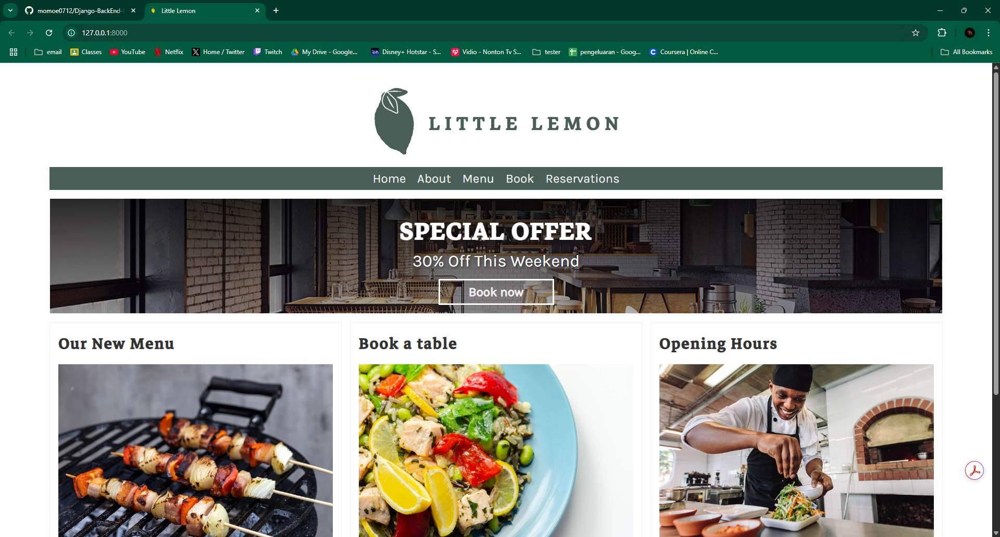
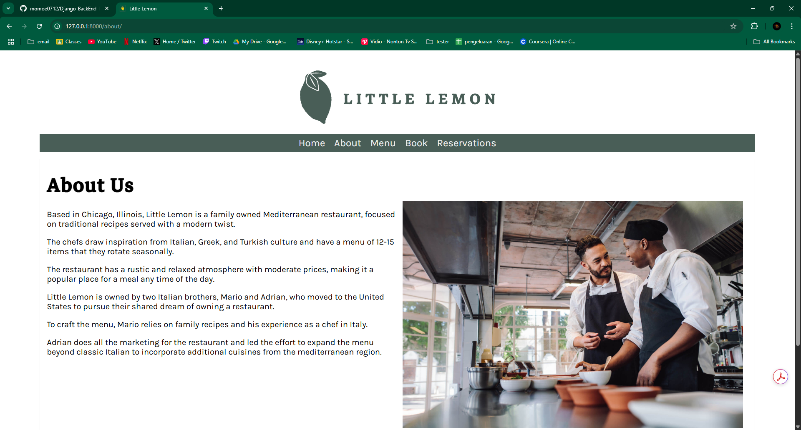

# Little Lemon – Django Back-End Project

A restaurant web application built with Django: menu pages, a table-booking flow, and a small JSON endpoint for reservations. It is the capstone project of the [Meta Back-End Developer Professional Certificate](https://www.coursera.org/professional-certificates/meta-back-end-developer) on Coursera, extended with automated tests, environment-based configuration, and a live deployment.

**Live demo:** https://momoe.pythonanywhere.com
*(Hosted on a free PythonAnywhere plan, so it may occasionally be offline.)*

> This is a learning project, not a production system. See [Known limitations](#known-limitations).

## Features

- Home and About pages built from reusable base and partial templates
- Menu list and menu item detail pages (dynamic URL parameter `menu_item/<pk>/`)
- Booking form (Django `ModelForm`) with a live list of bookings for the selected date
- JSON endpoint `/bookings` that returns reservations by date and rejects a new booking when the date and time slot is already taken
- Reservations page showing all bookings in a table
- Django admin for managing menu content
- Schema managed through Django migrations
- 12 automated tests (Django `TestCase`)

## Tech stack

Python 3 · Django 5.2 · SQLite · HTML / CSS / vanilla JavaScript

The course version used MySQL. This version uses SQLite so the project runs without installing a database server.

## Pages and endpoints

| URL | Description |
|---|---|
| `/` | Home page |
| `/about/` | About page |
| `/menu/` | Menu list |
| `/menu_item/<pk>/` | Menu item detail |
| `/book/` | Booking form |
| `/reservations/` | All reservations (table) |
| `/bookings?date=YYYY-MM-DD` | `GET`: reservations for a date, as JSON |
| `/bookings` | `POST` (JSON body with `first_name`, `reservation_date`, `reservation_slot`): create a booking, or return an error if the slot is taken |
| `/admin/` | Django admin |

## Run locally

```bash
git clone https://github.com/momoe0712/Django-BackEnd-Project.git
cd Django-BackEnd-Project

python -m venv venv
venv\Scripts\activate          

pip install -r requirements.txt

python manage.py migrate
python manage.py loaddata menu      
python manage.py createsuperuser    
```

Debug mode is off by default, so enable it for local development:

```bash
set DEBUG=True                  

python manage.py runserver
```

Open http://127.0.0.1:8000/.

## Run the tests

```bash
python manage.py test
```

The test suite covers:

- Model string representations
- Booking form validation (valid data, missing name)
- Page responses (home, about, book, reservations, menu) and menu list/detail content
- Reservations page content, including readable time labels
- Booking form submission saving a booking
- Booking endpoint: creating a booking, rejecting a taken slot, allowing the same slot on a different date, and filtering by date

## Configuration

Settings are read from environment variables, so no secrets are stored in the repository.

| Variable | Purpose | Default |
|---|---|---|
| `SECRET_KEY` | Django secret key | insecure dev-only key |
| `DEBUG` | `True` for local development | `False` |
| `ALLOWED_HOSTS` | Comma-separated host names | `localhost,127.0.0.1` |
| `CSRF_TRUSTED_ORIGINS` | Comma-separated origins, e.g. `https://example.com` | empty |

Always set a new `SECRET_KEY` in any deployed environment.

## Deployment

Deployed on PythonAnywhere (manual configuration, WSGI, virtualenv). After each `git pull` on the server:

```bash
python manage.py migrate
python manage.py collectstatic --noinput
```

then reload the web app.

## Known limitations

- `/bookings` is CSRF-exempt and has no authentication, as in the course material. Anyone can create a booking.
- Duplicate-slot protection is enforced in the JSON endpoint only. The `/book/` form view and the database do not enforce it (a `unique_together` constraint on date and slot would).
- The menu item page expects an image named after the item in `restaurant/static/img/menu_items/`.

## Screenshots

### Home page
<p align="left">
	
</p>

### About page
<p align="left">
	
</p>

## Acknowledgements

- [Meta Back-End Developer Professional Certificate](https://www.coursera.org/professional-certificates/meta-back-end-developer)
- [Django Docs](https://docs.djangoproject.com/)
- [Python Docs](https://docs.python.org/)